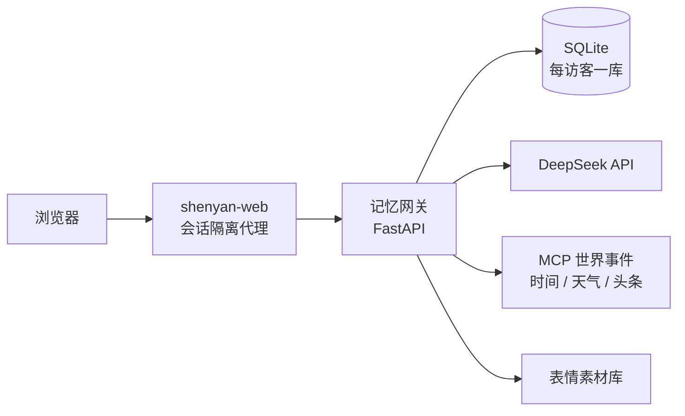

# 沈砚记忆网关 · Shenyan Memory Gateway

给 AI 角色用的长期记忆层：记忆存在自己的库里，写入要人点头，换一个 Base URL 就能接进任何对话产品。

**线上直接可玩** → <http://47.114.217.157:8080/>

3400 行 Python · 565 行前端 · 4 套离线测试 · 单实例跑在 2 GB 云主机上

## 现在能做什么

| 能力 | 线上怎么验证 | 实测 |
|---|---|---|
| 跨会话记忆 | 聊两句关掉，隔天再打开 | 历史保留 60 轮 |
| 人工审核闸门 | 右侧面板「待审 → 确认 / 拒绝」 | 每 5 轮出候选 |
| 表情 | 多聊几轮 | 约两轮一个 |
| 实时世界事件 | 问「现在几点」 | 时间 + 新加坡天气，1.2 秒内 |
| 主动消息 | 关掉页面，30 分钟后再开 | 后台生成，下次打开可见 |
| 用量统计 | 面板底部 | 一次对话约 3k tokens |

## 架构



渠道和模型两头都不绑定：今天接网页，明天接 QQ；换模型只改三个环境变量
（`LLM_BASE_URL` / `LLM_MODEL` / `LLM_API_KEY`）。

## 五个取舍

**1. 模型不返回 JSON，返回「正文 + 标记」**
每条回复都走 JSON 模式，失败面和延迟都翻倍。改成正文里写 `[[st:st_05]]`，
网关解析成动作列表；解析失败只丢一个表情，不会把整句话弄没。

**2. 表情是「选」不是「画」**
生成一张图要 5–15 秒，风格每张都不一样，聊天里等不起。
改成素材库带情绪标签，模型只在封闭集合里选 id——不会幻觉出图片地址。

**3. 实时信息不进记忆库**
「今天下雨」写进正史，三个月后角色还记着那场雨。所以分两级：
情境层十分钟过期，正史层要人审。

**4. MCP 客户端手写，不用官方 SDK**
网关跑在 AstrBot 基础镜像里，那个镜像锁了 pydantic 版本，装 SDK 会打架。
MCP 的 stdio 传输就是一行一个 JSON-RPC，实现 150 行，零新依赖，还能离线测试。

**5. 锁按会话分，不按进程**
最初是一把全局锁，一个人等 DeepSeek，所有人都得等。改成按会话取锁之后，
4 个并发会话总耗时 1.30 秒，等于单个的耗时——改之前是 5.21 秒。

## 实测

```
真模型回复          1.2 – 1.4 s
4 并发 vs 单个      1.30 s vs 1.30 s
一次对话            约 3000 tokens（prompt 2975 / completion 14）
网关常驻内存        69.3 MiB
部署形态            2 GB 云主机，单容器
```

## 已知边界

- 只有文本输入。表情和语音是**输出**侧能力，用户发来的图会被丢弃
- 语音只有协议没有 TTS，网页端用浏览器语音合成顶
- 检索是字符二元组，不是向量库；两三百条记忆之后会撞墙
- 没有多租户，一个实例服务一个角色
- 演示数据 7 天回收，超量的会话从最旧的删

## 跑起来

不用 Docker，也不用 API Key：

```bash
cd qq-bot-deploy/shenyan-memory
python start-demo.py            # 演示模式：固定话术，不调用模型
python start-demo.py --live     # 接真模型，会提示输入 Key
```

打开 <http://127.0.0.1:8080>。

## 测试

```bash
python qq-bot-deploy/shenyan-memory/tests/test_multimodal.py   # 动作协议 + MCP + 端到端
python qq-bot-deploy/shenyan-memory/tests/test_proactive.py    # 主动消息调度与冷却
python web-demo/tests/test_isolation.py                        # 访客之间互不可见
python web-demo/tests/test_proxy_guard.py                      # 指令白名单与限流
```

四套都只用标准库，靠假模块顶替 fastapi / openai / httpx，所以 CI 里不需要 `pip install`。

## 目录

```
qq-bot-deploy/shenyan-memory/
  shenyan-gateway/     FastAPI：检索、审核、动作协议、MCP 客户端
    app.py             主服务（锁、路由、调度）
    actions.py         输出协议：正文 → 动作
    stickers.py        素材库
    world.py           情境缓存
    mcp_stdio.py       MCP 客户端（stdio, JSON-RPC 2.0）
    world_server.py    MCP 服务端（时间 / 天气 / 头条）
  shenyan-persona/     演示角色设定与种子记忆
  shenyan-assets/      表情素材（Fluent Emoji, MIT）
  scripts/             启动、冒烟测试、素材生成
  tests/               离线测试
  start-demo.py        本机启动入口
web-demo/              网页层：会话隔离代理 + 单页前端
docs/                  产品案例页
.github/workflows/     每次 push 跑四套离线测试
```

## 许可

代码 MIT。表情素材来自 [Microsoft Fluent Emoji](https://github.com/microsoft/fluentui-emoji)（MIT）。
